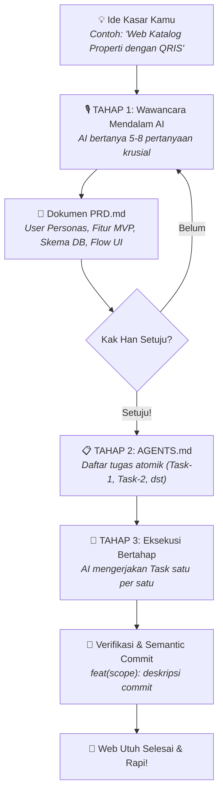

<div align="center">

# ⚡ Next Vibe Starter

### *The Ultimate Anti-Slop Vibe Coding Boilerplate & AI Ruleset*

Kerangka web modern bertenaga **Next.js 15 (App Router)**, **Tailwind CSS**, dan **TypeScript**, dipersenjatai dengan **Ruleset AI Disiplin** yang memaksa AI melakukan **wawancara PRD mendalam** sebelum menulis satu baris kode pun.

[](https://nextjs.org/)
[](https://react.dev/)
[](https://tailwindcss.com/)
[](https://www.typescriptlang.org/)
[](https://github.com/amascar23/next-vibe-starter)
[](LICENSE)

[Fitur Utama](#-fitur-utama) • [Setup 30 Detik](#-setup-otomatis-di-laptop-30-detik) • [Alur Vibe 3-Tahap](#-alur-kerja-progressive-disclosure) • [Protokol Interview PRD](#-protokol-wajib-wawancara-prd-anti-slop) • [Cheat Sheet Prompt](#-cheat-sheet-prompt-untuk-kak-han)

---

</div>

## 💡 Filosofi: Kenapa Repo Ini Dibuat?

Untuk melakukan *vibe coding* dari nol hingga menjadi aplikasi web utuh yang siap pakai, kamu **tidak membutuhkan satu repo ajaib**, melainkan kombinasi harmonis antara:

1. **Boilerplate Berkualitas Tinggi (Kerangka Web)**: Menggunakan standar emas Next.js 15 App Router, Tailwind CSS, dan komponen modular bergaya `shadcn/ui`.
2. **Ruleset Disiplin AI (Anti-Slop Guardrails)**: Kumpulan aturan ketat (`.cursorrules`, `.cursor/rules/`, `.windsurfrules`, `CLAUDE.md`) yang melarang AI bertindak serampangan. AI dipaksa berpikir seperti *Senior Software Architect*, mewawancarai kebutuhanmu menjadi `PRD.md`, memecahnya ke `AGENTS.md`, baru mengeksekusinya secara bertahap.

Dengan setup ini, kamu yang tidak tahu cara menulis kodenya hanya perlu bertindak sebagai **Product Manager** yang mengarahkan visi produk, sementara AI mengeksekusi kodenya secara terstruktur, rapi, dan bebas dari *AI slop*.

---

## 🚀 Setup Otomatis di Laptop (30 Detik)

Kamu bisa langsung memanggil repositori ini kapan saja di laptopmu dengan satu perintah:

### ⚡ Opsi 1: Menggunakan Git Clone & Skrip Otomatis (Direkomendasikan)

Buka terminal (PowerShell / Command Prompt) di laptopmu dan jalankan:

```powershell
# 1. Clone repositori ke folder proyek barumu
git clone https://github.com/amascar23/next-vibe-starter.git nama-web-kamu

# 2. Masuk ke folder proyek
cd nama-web-kamu

# 3. Jalankan setup otomatis 1-klik (Windows)
.\setup.bat
```

> **Catatan**: Skrip `setup.bat` (atau `setup.ps1`) akan otomatis memeriksa instalasi Node.js, membuat file `.env.local`, dan menginstall semua dependensi.

---

### 📦 Opsi 2: Menggunakan `degit` (Template Bersih Tanpa History Git Lama)

```bash
# Download template bersih
npx degit amascar23/next-vibe-starter nama-web-kamu

# Masuk dan setup
cd nama-web-kamu
npm run setup
npm install
npm run dev
```

Buka browser di [http://localhost:3000](http://localhost:3000) untuk melihat dashboard starter interaktif.

---

## 🔄 Alur Kerja: Progressive Disclosure

Proses pengembangan dibagi menjadi 3 tahap terkontrol agar AI tidak berhalusinasi atau menulis kode yang rusak:



---

## 🎙️ Protokol Wajib Wawancara PRD (Anti-Slop)

> ⚠️ **Aturan Emas**: AI dilarang keras menyentuh kode program sebelum dokumen `PRD.md` disetujui!

Saat kamu memberikan ide kasar, AI secara otomatis akan menanyakan pertanyaan mendalam mencakup 6 dimensi utama:

1. **Target Pengguna & Persona**: Siapa pengguna web ini? Apakah ada pemisahan peran (misal: Pembeli vs Penjual, Member vs Admin)?
2. **Fitur Inti MVP**: Apa 3–5 fitur mutlak yang harus jalan di versi pertama? Fitur apa yang bisa ditunda?
3. **User Flow & Halaman**: Bagaimana alur navigasi dari pengunjung datang sampai tujuan selesai? Halaman apa saja yang dibutuhkan?
4. **Integrasi & Database**: Apakah butuh database seperti Supabase/PostgreSQL? Butuh pembayaran QRIS/Midtrans? Notifikasi WhatsApp/Email?
5. **Preferensi Desain**: Gaya visual apa yang diinginkan (Modern minimalis, Dark mode luxury, Playful)? Ada contoh website referensi?
6. **Aturan Bisnis Khusus**: Ada batasan kuota, diskon khusus, atau logika perhitungan rumit?

> 💡 **Mau wawancara lewat terminal?** Kamu juga bisa menjalankan `npm run interview` di terminal untuk menjawab pertanyaan secara interaktif!

---

## 💬 Cheat Sheet Prompt untuk Kak Han

Salin prompt di bawah ini ke AI kesayanganmu (Cursor / Windsurf / Cline / Antigravity):

### 1️⃣ Prompt Memulai Ide (Pemicu Interview PRD)
```text
Mulai proyek baru. Saya ingin membuat: [Tuliskan ide kasarmu di sini].

ATURAN WAJIB:
1. Jangan tulis kode apa pun terlebih dahulu.
2. Bertindaklah sebagai Senior Product Manager & Software Architect.
3. Wawancarai saya secara detail (5-8 pertanyaan terarah) mengenai target pengguna, fitur inti MVP, alur halaman, database/integrasi, dan preferensi desain.
4. Setelah saya menjawab, rumuskan hasilnya ke dalam file PRD.md dan tunggu persetujuan saya.
```

### 2️⃣ Prompt Breakdown Tugas (`AGENTS.md`)
```text
Saya sudah memeriksa dan menyetujui dokumen PRD.md.
Sekarang tolong pecah kebutuhan tersebut menjadi daftar tugas atomik di dalam file AGENTS.md (Task-1, Task-2, dst.) lengkap dengan Acceptance Criteria dan checkbox [ ]. Jangan mulai ngoding sebelum saya minta.
```

### 3️⃣ Prompt Eksekusi Task
```text
Silakan eksekusi [Task-1: Judul Task] yang ada di AGENTS.md.
Gunakan standar Next.js 15 App Router, TypeScript ketat, dan Tailwind CSS modular. Tandai [x] jika sudah selesai.
```

### 4️⃣ Prompt Semantic Git Commit
```text
Fitur pada task ini sudah selesai diuji. Tolong buatkan commit git semantik sesuai aturan di .cursor/rules/04-semantic-git.mdc (contoh: feat(catalog): add responsive product grid) dan lakukan commit sekarang.
```

---

## 🛡️ Aturan Anti-Slop yang Ditanamkan

Boilerplate ini mengadopsi standar terbaik dari komunitas open-source ternama:

* **Inspirasi `miqdadbadjuber/anti-slop` & `Nutlope/hallmark`**:
  * Melarang file raksasa (maksimal 200 baris per komponen).
  * Melarang penggunaan tipe `any` atau `@ts-ignore`.
  * Wajib memisahkan Server Components (RSC) dan Client Components (`"use client"`).
  * Menjamin layout responsif tanpa merusak *grid* atau *horizontal scroll*.
* **Inspirasi `jalaalrd/anti-ai-slop-writing`**:
  * Menuntun AI dalam merancang arsitektur, mendefinisikan *database schema*, dan membuat *flow* UX yang matang sebelum menulis kode.
* **Inspirasi `ArisMukti/semantic-git-rules`**:
  * Standar Conventional Commits otomatis (`feat`, `fix`, `docs`, `refactor`, `chore`).

---

## 📁 Struktur Folder Proyek

```text
next-vibe-starter/
├── PRD.md                         # 📄 Dokumen PRD aktif (hasil wawancara AI)
├── PRD.template.md                # 📋 Template master PRD 10-seksi
├── AGENTS.md                      # 🤖 Task manager pelacak progres eksekusi
├── TASKS.template.md              # 📋 Template breakdown tugas atomik
├── PROMPTS.md                     # 💡 Kumpulan prompt siap pakai untuk Kak Han
├── .cursorrules                   # 🧠 Master rule untuk Cursor IDE
├── .cursor/rules/                 # 📂 Modular rules (Interview, Anti-Slop, Stack, Git)
│   ├── 00-mandatory-prd-interview.mdc
│   ├── 01-anti-slop-standards.mdc
│   ├── 02-nextjs-tailwind-stack.mdc
│   ├── 03-progressive-disclosure.mdc
│   └── 04-semantic-git.mdc
├── .windsurfrules                 # 🌊 Rules untuk Windsurf Cascade
├── CLAUDE.md                      # 🤖 Instruksi untuk Claude Code & Cline
├── setup.bat / setup.ps1          # ⚡ Skrip setup otomatis 1-klik untuk Windows
├── scripts/
│   ├── setup.js                   # 🛠️ Cross-platform onboarding runner
│   └── interview-cli.js           # 🎙️ Wizard wawancara interaktif via terminal
└── src/
    ├── app/                       # ⚡ Next.js 15 App Router
    │   ├── layout.tsx             # Root layout & meta tags
    │   ├── page.tsx               # Halaman utama dengan interactive cockpit
    │   ├── globals.css            # Tailwind base & CSS variables
    │   └── api/health/route.ts    # Health check endpoint
    ├── components/
    │   ├── ui/                    # Komponen primitif shadcn (Button, Card, Badge)
    │   ├── layout/                # Header & Footer responsif
    │   └── vibe-cockpit.tsx       # Komponen interaktif kokpit prompt
    └── lib/
        └── utils.ts               # Helper merge Tailwind class (cn)
```

---

## 🤖 Kompatibilitas AI Editor

| AI Tool / Editor | Status Dukungan | File Konfigurasi yang Digunakan |
| :--- | :---: | :--- |
| **Cursor** | ⭐ Native Support | `.cursorrules`, `.cursor/rules/*.mdc` |
| **Windsurf (Cascade)** | ⭐ Native Support | `.windsurfrules`, `AGENTS.md` |
| **Google Antigravity** | ⭐ Native Support | `.gemini/rules/`, `AGENTS.md` |
| **Cline / Roo Code** | ⭐ Native Support | `CLAUDE.md`, `.cursorrules` |
| **GitHub Copilot** | ⭐ Native Support | `.cursorrules`, `PRD.md` |

---

## 📄 Lisensi

Didistribusikan di bawah lisensi **MIT**. Bebas digunakan, dimodifikasi, dan disebarluaskan untuk proyek komersial maupun pribadi.

---

<div align="center">

Dibuat dengan ❤️ untuk seluruh **Product Managers** dan **Vibe Coders** yang ingin menghasilkan web berkelas dunia tanpa pusing menulis kode dari nol.

**[⭐ Berikan Star di GitHub jika starter ini membantu perjalanan Vibe Coding kamu!](https://github.com/amascar23/next-vibe-starter)**

</div>
