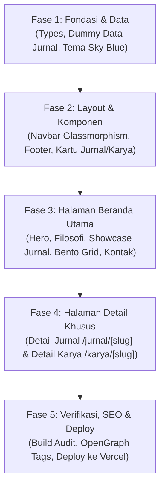

# 🗺️ ROADMAP PENGEMBANGAN WEBSITE PORTOFOLIO & JURNAL ANNISA

> **Nama Proyek**: Portofolio Pendidik & Akademisi Annisa (`profilAnnisa`)  
> **Pemilik Proyek**: Annisa (Kak Han)  
> **Peran Utama**: Pendidik / Guru & Peneliti Pendidikan  
> **Tema Visual**: *Pastel Creative (Dominan Biru Langit / Sky Blue)*  
> **Arsitektur**: Next.js 15 App Router + Tailwind CSS + shadcn/ui + TypeScript  
> **Status**: Fase Perencanaan Selesai — Siap Eksekusi  

---

## 📌 Ringkasan Visi & Tujuan
Membangun platform portofolio digital terpadu yang memadukan rekam jejak pengajaran, karya inovasi pembelajaran kelas, dan publikasi jurnal ilmiah secara profesional, hangat, serta mudah diakses oleh sesama guru, rekan mahasiswa, dan masyarakat umum.

---

## 🏗️ Struktur & Arsitektur Direktori Proyek

```
profilAnnisa/
├── public/                       # Aset Statis Publik
│   ├── images/                   # Foto profil, foto kegiatan kelas, thumbnail karya
│   └── docs/                     # Berkas CV Guru (PDF), sample jurnal/modul ajar
│
├── src/
│   ├── app/                      # Next.js 15 App Router
│   │   ├── api/health/           # Endpoint health-check
│   │   ├── jurnal/[slug]/        # Dynamic route: Halaman Detail Jurnal Ilmiah
│   │   ├── karya/[slug]/         # Dynamic route: Halaman Detail Karya & Inovasi Ajar
│   │   ├── globals.css           # Styling global & token warna Pastel Sky Blue
│   │   ├── layout.tsx            # Root layout (Metadata SEO, Theme Wrapper, Navbar & Footer)
│   │   └── page.tsx              # Landing page utama (Single-page scroll hub)
│   │
│   ├── components/               # Komponen UI Modular (< 200 baris/file)
│   │   ├── layout/               # Header Glassmorphism & Footer Edukasi
│   │   ├── portfolio/            # Kartu Jurnal, Kartu Karya, Timeline Item
│   │   ├── sections/             # Seksi Hero, About, Jurnal, Karya, Skills, Pengalaman, Kontak
│   │   └── ui/                   # Primitive shadcn/ui (Button, Badge, Card, Dialog)
│   │
│   ├── data/
│   │   └── portfolio.ts          # Single Source of Truth (Dummy data realistis & terpusat)
│   │
│   ├── lib/
│   │   └── utils.ts              # Helper functions (cn helper, formatter tanggal)
│   │
│   └── types/
│       ├── portfolio.ts          # Kontrak interface TypeScript (Profile, Journal, Project, Timeline)
│       └── index.ts              # Export sentralisasi types
│
├── AGENTS.md                     # Task breakdown atomik AI Agent Task Manager
├── PRD.md                        # Product Requirements Document yang telah disetujui
├── roadmaps.md                   # Dokumen peta jalan (Roadmap) pengembangan web
└── package.json                  # Konfigurasi dependensi Next.js 15 & script build
```

---

## 🔄 Alur & Fase Pengembangan (Roadmap Workflow)



---

## 📅 Roadmap Tahapan Eksekusi

### 🔷 Fase 1: Fondasi, Tema & Skema Data
*Target: Menyiapkan model data type-safe dan identitas visual pastel biru langit.*

| Task | Deskripsi | Output File | Status |
| :--- | :--- | :--- | :---: |
| **Task 1** | Definisi Type Data TypeScript (Profil Guru, Jurnal, Karya Ajar, Timeline) | `src/types/portfolio.ts` | ✅ Done |
| **Task 2** | Mock Data Realistis Pendidik & Jurnal Ilmiah SINTA/ISSN | `src/data/portfolio.ts` | ✅ Done |
| **Task 3** | Setup Tema Pastel Sky Blue (`sky-400`, `sky-500`, soft tints) & Toggle Mode | `tailwind.config.ts`, `globals.css` | ✅ Done |

---

### 🔷 Fase 2: Shell Layout & Komponen Modular
*Target: Membangun rangka navigasi responsif dan komponen kartu informasi yang dapat digunakan kembali.*

| Task | Deskripsi | Output File | Status |
| :--- | :--- | :--- | :---: |
| **Task 4** | Navbar Glassmorphism sticky + mobile drawer & Footer ramah | `src/components/layout/` | ✅ Done |
| **Task 5** | Komponen Kartu Jurnal (Badge SINTA/ISSN, PDF button) & Kartu Karya Ajar | `src/components/portfolio/` | ✅ Done |

---

### 🔷 Fase 3: Perakitan Halaman Utama (Single-Page Scroll)
*Target: Mengintegrasikan seluruh seksi konten edukasi ke halaman beranda yang interaktif dan responsif.*

| Task | Deskripsi | Output File | Status |
| :--- | :--- | :--- | :---: |
| **Task 6** | Seksi Hero (Avatar, Moto Guru, Status Kolaborasi, CTA) & Seksi Filosofi Mengajar | `src/components/sections/hero-section.tsx`, `about-section.tsx` | ✅ Done |
| **Task 7** | Seksi Galeri Jurnal Ilmiah & Showcase Karya Inovasi Belajar | `src/components/sections/journals-section.tsx`, `teaching-section.tsx` | ✅ Done |
| **Task 8** | Bento Grid Keahlian EdTech, Timeline Pengalaman Mengajar, Testimoni & Kontak 1-Klik | `src/components/sections/`, `src/app/page.tsx` | ✅ Done |

---

### 🔷 Fase 4: Halaman Detail Khusus (Multi-Page Deep Dive)
*Target: Memberikan ruang membaca yang luas dan nyaman untuk karya akademis dan inovasi kurikulum.*

| Task | Deskripsi | Output File | Status |
| :--- | :--- | :--- | :---: |
| **Task 9** | Halaman Detail Jurnal Ilmiah: Abstrak lengkap, metodologi, download full paper | `src/app/jurnal/[slug]/page.tsx` | ✅ Done |
| **Task 10** | Halaman Detail Modul Ajar: Kurikulum, implementasi kelas, dampak pada murid | `src/app/karya/[slug]/page.tsx` | ✅ Done |

---

### 🔷 Fase 5: Polish, Audit SEO & Kesiapan Deploy
*Target: Verifikasi performa sempurna, ramah mesin pencari, dan publikasi online.*

| Task | Deskripsi | Output File | Status |
| :--- | :--- | :--- | :---: |
| **Task 11** | OpenGraph Card, Favicon Edukasi & Metadata Media Sosial | `src/app/layout.tsx` | ⏳ Ready |
| **Task 12** | Validasi Build Tanpa Error (`npm run build`) & Panduan Deploy ke Vercel | Laporan Build & Deploy | ⏳ Ready |

---

## 💡 Panduan Manajemen & Kustomisasi Konten Mandiri (Untuk Annisa)

Setelah website selesai dibangun, Annisa dapat memperbarui konten kapan saja dengan sangat mudah tanpa menyentuh kode rumit:

1. **Mengubah Foto Profil & Aset CV**:
   - Letakkan foto profil baru di `public/images/profile.jpg`.
   - Letakkan berkas CV Guru format PDF di `public/docs/cv-annisa.pdf`.
2. **Menambahkan Jurnal Ilmiah Baru**:
   - Buka file `src/data/portfolio.ts`.
   - Tambahkan objek baru pada array `journalsData` dengan judul, nama jurnal, tahun, dan abstrak.
3. **Mengubah Kontak WhatsApp / Email**:
   - Cukup edit field `whatsappNumber` dan `email` di `src/data/portfolio.ts`.
4. **Deploy ke Vercel**:
   - Hubungkan repository GitHub ini ke akun [Vercel](https://vercel.com).
   - Setiap kali ada `git push` ke branch `main`, website akan otomatis ter-update secara instan (*auto-deploy*).

